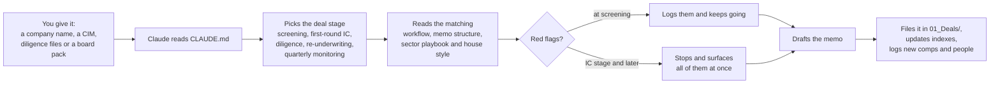

# PE Deal Vault

**An Obsidian knowledge system for private equity deal work, built so an AI agent can run it.**

The vault holds a full underwriting playbook as plain markdown: deal-stage workflows, memo structures, sector playbooks, red-flag triggers and analysis templates. Point Claude at the folder and the [`CLAUDE.md`](CLAUDE.md) file turns it into an agent. Hand it a company name, a CIM or a quarter's board pack, and it picks the right deal stage, reads the matching playbooks, drafts the memo in house style, and files it back into the vault with every company, person and comp linked.

I built this during my 2026 private equity internship. It is the knowledge base behind [Pulse](https://github.com/elliswerner4/pulse-reunderwriting-agent), my AI re-underwriting agent. This public version is the generic template: every firm-specific file, deal and person has been removed. The one deal included, Ridgeline Infusion Partners, is a fictional example.

## How it works

**The rules it follows**, all written in the vault itself:

- **Every claim carries a confidence tag:** `[FACT]`, `[REPORTED]`, `[ESTIMATE]`, `[INFERENCE]` or `[VERIFY]`.
- **No bare numbers.** Every figure has units and a source or a shown derivation.
- **Recommendation first.** The executive summary comes in the first 200 words.
- **A real bear case.** Every memo has a "what would make us wrong" section.
- **Skipped documents are logged** as explicit limitations, never left as silent gaps.
- **Sign-off lines stay blank.** It never concludes valuation on a conflicted transaction.

## What's inside

| Folder | Contents |
|---|---|
| `00_Home.md` | Dashboard: active deals and navigation |
| `01_Deals/` | One folder per deal (hub note, memos, meeting notes), including a fictional worked example |
| `02_Portfolio/` | Companies under recurring monitoring |
| `03_Frameworks/` | Deal lifecycle, 5 stage workflows, 5 memo structures, the 8-question framework, 10 red-flag triggers, document checklists, monitoring cadence, house style |
| `04_Sectors/` | 6 sector playbooks: healthcare services, vertical SaaS, business services, industrial growth, consumer, financial services |
| `05_Analysis Library/` | EBITDA bridge, working capital peg, net debt definition, LBO summary, sensitivity grids, risk matrix, diligence findings |
| `06_People & Firms/` | One note per person and firm; backlinks build the relationship map |
| `07_Market Intel/` | Comps log, precedent transactions, banker coverage |
| `99_Templates/` | Note templates for deals, memos, meetings, people and firms |

The idea behind it: individual deals end, but pattern recognition compounds. Every deal note links to the sector it tested, the people involved, the comps it produced and the red flags it raised. After two years, opening a sector note shows every deal you've seen in that space.

## Use it

1. Download or clone this repo and open the folder as a vault in [Obsidian](https://obsidian.md). It's free, local and offline, and needs no plugins.
2. Turn on the core **Templates** plugin and set its folder to `99_Templates`.
3. Replace `{{FIRM NAME}}` and `{{CITY}}` in `03_Frameworks/House Style.md`.
4. To run it as an agent, open the folder with Claude Code or another assistant that reads `CLAUDE.md`, and give it a company.

See [`README — Start Here.md`](README%20%E2%80%94%20Start%20Here.md) for the full in-vault guide.

---

**Ellis Werner** · MBA candidate, UVA Darden School of Business · [LinkedIn](https://www.linkedin.com/in/Ellis-W-Werner) · [GitHub](https://github.com/elliswerner4)
